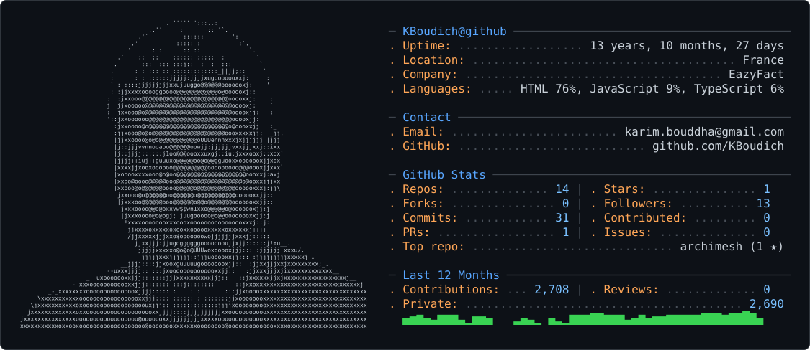

<picture>
  <source media="(prefers-color-scheme: dark)" srcset="dark_mode.svg" />
  <source media="(prefers-color-scheme: light)" srcset="light_mode.svg" />
  
</picture>

## Solution Architect & System Designer

I build practical systems that help teams reason clearly, run reliably, and turn complex work into confident decisions.

For more than 20 years, I have worked across cloud architecture and full-stack development with technologies including React, TypeScript, Node.js, .NET, and C#. I share hands-on lessons from building systems, mentoring engineers, and guiding teams through articles designed to help others solve real problems and grow in their careers.

### Selected work

- **Archmesh** — A trust layer for multi-agent architecture reviews, built around structured debate, explicit permissions, and bounded spend.
- **EazyFact** — An invoicing SaaS that simplifies creating, managing, and following up invoices for growing businesses.
- **Artineo** — A transportation management system for real-time logistics coordination and secure multi-tenant workflows.
- **DiagramR** — A faster way to turn technical thinking into clear architecture diagrams.
- **Ezzo** — An AI-native ERP in development for more fluent, connected, and actionable business operations.

### Writing

I write about cloud architecture, clean code, AI systems, and the engineering decisions behind reliable software.

[Read my articles](https://karim-boudich.com/posts/) · [Visit my website](https://karim-boudich.com/)
